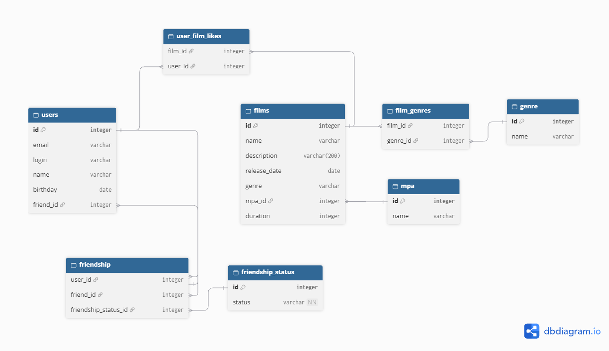

# java-filmorate
Болванка проекта рейтинговой платформы для сайтов Filmorate.


# Таблицы

| Таблица | Назначение |
|---------|-----------|
| `users` | Пользователи |
| `films` | Фильмы |
| `friendship` | Доп. таблица связи многие ко многим: статус дружбы |
| `friendship_status` | Cправочная таблица на статус дружбы |
| `mpa` | Справочная таблица на список MPA |
| `genres` | Справочная таблица жанров |
| `user_film_likes` |  Доп. таблица связи многие ко многим: пользователи и их лайки на фильмы |
| `film_genres` | Доп. таблица связи многие ко многим: фильмы и их жанры |

# Примеры основных SQL-запросов
1. Добавление пользователя
```
INSERT INTO users (email, login, name, birthday, friendship_status_id)
VALUES ('user@mail.ru', 'user', 'User', '2005-05-27', 1);
```
2. Получение списка фильмов
```
SELECT f.*
FROM films f
JOIN mpa m ON f.mpa_id = m.id;
```
3. Обновление данных фильма
```
UPDATE films
SET name = 'Афёра',
    description = 'Папа иллюзии обмана',
    duration = 139
WHERE id = 1;
```
4. Добавление лайка
```
INSERT INTO user_film_likes (film_id, user_id)
VALUES (1);
```
